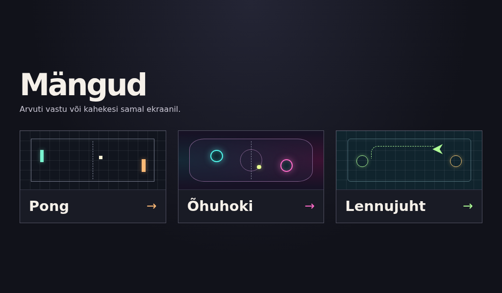

# Puutetundliku ekraani mängud

Kolm veebimängu Raspberry Pi 400 ja 7-tollise puuteekraani jaoks. Kõigis saab mängida üksi arvuti vastu või kahekesi samal ekraanil. Mängud töötavad Chromiumis ja pärast allalaadimist saab neid mängida internetiühenduseta.

**Uue ekraani seadistamisel** alusta kahe sõrme katsest. Juhend aitab ka siis, kui pilt on ees ja sõrm liigutab kursorit, kuid Chromium kuvab üksnes hiirt. [Puutetuvastus, mitmikpuute seadistus ja teised ekraanimudelid](docs/puuteekraan.md)

| Mäng | Mida puutega teha saab | Dokumentatsioon |
| --- | --- | --- |
| Pong | Liiguta korraga kaht reketit, kumbagi ühel teljel. | [Pongi juhend](docs/pong.md) |
| Õhuhoki | Liiguta löögikettaid kahel teljel ja suuna litrit löögi kiiruse ning suunaga. | [Õhuhoki juhend](docs/ohuhoki.md) |
| Lennujuht | Joonista korraga kahele laevale marsruut ja jälgi gravitatsioonist kõverduvat trajektoori. | [Lennujuhi juhend](docs/lennujuht.md) |



Avaleht ja mängujuhendite ekraanipildid on jäädvustatud Raspberry Pi 400 Chromiumis 1024 × 600 vaates.

## Alusta Raspberry Pi-s

1. Ühenda pilt HDMI kaudu ja puude ekraani andmesidet toetava USB-kaabli kaudu. Kui ekraan on juba ühendatud, võid kohe mängud alla laadida.
2. Ava Pi töölaual terminal ning käivita järgmised käsud.

   ```bash
   cd ~
   git clone https://github.com/nullyks/puutetundliku-ekraani-mangud.git
   cd puutetundliku-ekraani-mangud
   chromium "file://$PWD/index.html"
   ```

3. Vali [mängude avalehelt](index.html) mäng. Iga mängu ülaservas olev **Mängud** viib tagasi avalehele ka pausi ajal ja pärast vooru lõppu.
4. Enne kahekesi mängimist kinnita kahe samaaegse kontakti töö. [Chromiumi kahe sõrme katse](docs/puuteekraan.md#1-kinnita-kaks-kontakti-chromiumis)

Avaliku repo kloonimiseks ja uuendamiseks piisab Gitist. Kui repo on juba olemas, tõmba uus versioon ja laadi Chromiumis avatud leht klahvidega `Ctrl+R` uuesti.

```bash
git -C ~/puutetundliku-ekraani-mangud pull --ff-only
```

Kui Git või Chromium puudub, paigalda vajalik pakett Raspberry Pi OS-is käsuga `sudo apt install git` või `sudo apt install chromium`.

## Arendamine ja testimine

Mängud kasutavad HTML-i, CSS-i, JavaScripti ja Canvas 2D-d. Mänguloogika jookseb brauserist eraldi testitavates mootorifailides. Kõik loogikatestid käivituvad repo juurkaustas Node.js-iga.

```bash
node --test
```

1. Katseta muutunud loogikat Node.js-is ning menüüsid ja juhtimist Chromiumis.
2. Tõmba avaldatud versioon Pi-sse ja laadi mäng uuesti. Raspberry Pi Connecti **Remote shell** sobib käskude käivitamiseks ja **Screen sharing** kuva kontrollimiseks. [Raspberry Pi Connecti juhend](https://www.raspberrypi.com/documentation/services/connect.html)
3. Sisendimuudatuse järel tee kahe sõrme katse Pi enda ekraanil. Brauseris emuleeritud puutega saab kontrollida mängu sisendiloogikat. Füüsiline katse kinnitab kogu teekonna ekraani kontrollerist mänguni. Täpsed katsesammud on iga mängu juhendis ja [puuteekraani juhendis](docs/puuteekraan.md).

Lisades mängu, tee sellele oma HTML-leht ja lisa valik faili [`index.html`](index.html). Kasuta mängulehe ülaservas **Mängud** linki tagasi avalehele. Avalehe kujundus on failis [`games.css`](games.css). Lisa mängu juhend kausta `docs/` sama ülesehitusega nagu ülal lingitud juhendites.
