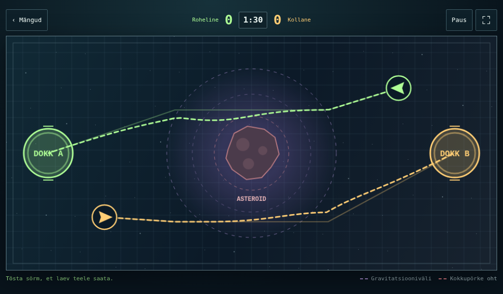
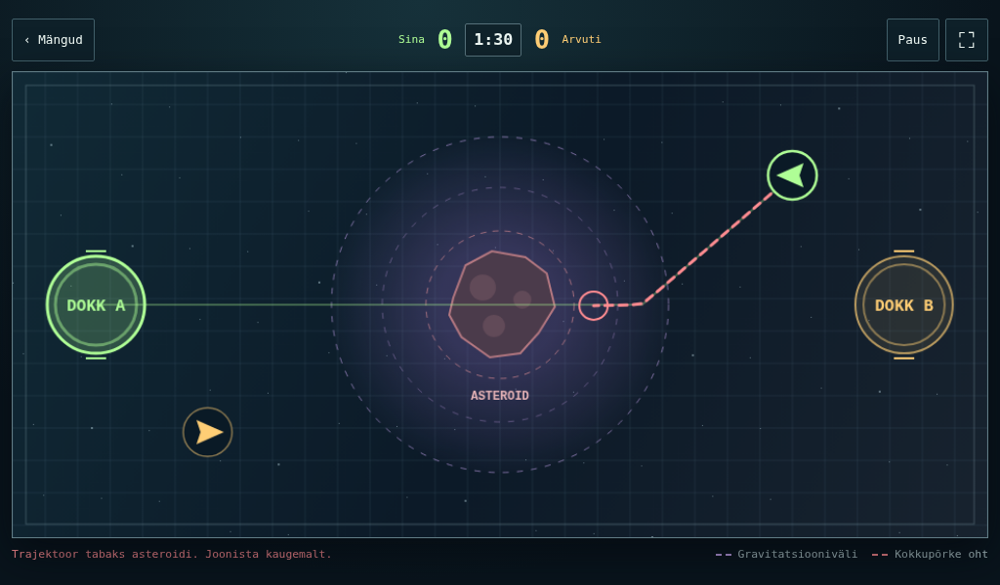
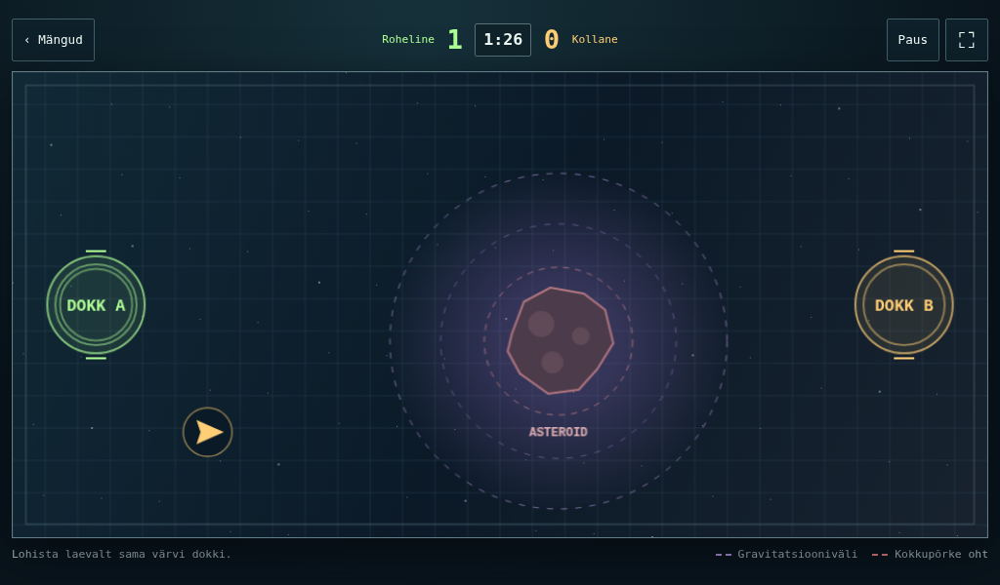

# Lennujuht

Lennujuht on kosmosesadama marsruudimäng. Joonista radarile laevade lennurajad, väldi kokkupõrkeid ja too võimalikult palju laevu õigesse dokki.

## Käivitamine

Vali [mängude avalehelt](../index.html) **Lennujuht** või ava [`lennujuht.html`](../lennujuht.html) Chromiumis. Repo esmakordse allalaadimise juhend on [README-s](../README.md#alusta-raspberry-pi-s). Kahe sõrmega mängimiseks kontrolli [mitmikpuudet](puuteekraan.md).

## Juhtimine ja reeglid

| Režiim | Puutega | Muu sisend |
| --- | --- | --- |
| **Üksinda** | Joonista rohelistele laevadele rada dokki A. Kollased laevad juhib dokki B arvuti. | Roheliste laevade radu saab joonistada ka hiirega. |
| **Kahekesi** | Kumbki mängija joonistab oma värvi laevadele rada. Kaht marsruuti saab korraga joonistada ja eraldi käivitada. | Ühe hiirega saab mängida kordamööda, joonistades ühe marsruudi korraga. |

- Alusta ootel laevalt ja lõpeta sama värvi dokis. Rada läheb sõrme tõstmisel käiku. Kiire puudutus valib laeva ja kuvab selle sihtdoki.
- Asteroid liigub aeglaselt sadama keskosas. Selle lilla gravitatsiooniväli tõmbab lähedal lendavaid laevu enda poole. Peen joon näitab joonistatud rada ja katkendjoon prognoositud trajektoori.
- Punane eelvaade tähistab asteroidiohtu, võimalikku kokkupõrget teise laevaga või valet dokki. Asteroidi tabav või vales dokis lõppev marsruut tuleb ümber joonistada. Teise laevaga seotud hoiatus lubab marsruudi käivitada. Kokkupõrkel kaovad mõlemad laevad. Asteroidi tabanud laev kaob samuti.
- Dokkimine annab ühe punkti. Võidab mängija, kes toob **90 sekundi** jooksul rohkem laevu dokki. Võrdsete punktide korral on tulemuseks viik.
- **Paus** või `Esc` peatab mängu. Pausimenüüst saab jätkata või naasta režiimivalikusse. Pärast vooru saab sama režiimiga uuesti alustada. Täisekraani avab `⛶` või `F11`. **Mängud** viib avalehele.

## Ekraanipildid



*Kahe mängijaga voorus joonistavad mõlemad mängijad korraga. Lilla gravitatsioonivälja lähedal kaldub katkendjoon joonistatud rajast kõrvale.*



*Üksikmängus viib joonistatud rada asteroidi poole. Punane ring märgib prognoositud kokkupõrkekohta.*



*Roheline laev jõudis dokki A. Doki ümber ilmub ring ja rohelise mängija skoor suureneb ühe võrra.*

## Arendus ja failid

Lennujuhi mitmikpuude võimaldab joonistada ja kinnitada iga sõrmega eraldi marsruudi. Brauser hoiab joonistatavaid radu `pointerId` järgi lahus. Mootor kontrollib dokki, ennustab kokkupõrkeid ja valib arvutivastasele sobiva lennukoridori. [Esimene demoversioon](https://github.com/nullyks/puutetundliku-ekraani-mangud/commit/cf6dbe0)

Asteroidi asukoht sõltub vooru kulunud ajast ja selle liikumisala jätab mänguvälja servad vabaks. Gravitatsioon tugevneb asteroidile lähenedes. Laeva juhtimine suunab selle järk-järgult joonistatud rajale tagasi. Eelvaade kasutab sama 1/60 sekundi lennusammu kui mäng ja arvestab asteroidi tulevase asukohaga. [Liikuva asteroidi uuendus](https://github.com/nullyks/puutetundliku-ekraani-mangud/commit/72a9904)

| Fail | Ülesanne |
| --- | --- |
| [`lennujuht.html`](../lennujuht.html), [`lennujuht.css`](../lennujuht.css) | Mänguleht, menüüd, punktiseis ja radarikujundus. |
| [`lennujuht.js`](../lennujuht.js) | Canvas-radar, puutesisend, trajektoori eelvaade, paus ja režiimivalik. |
| [`lennujuht-engine.js`](../lennujuht-engine.js) | Marsruudid, dokkimine, gravitatsioon, kokkupõrkeprognoos ning arvutivastane. |
| [`lennujuht-engine.test.cjs`](../lennujuht-engine.test.cjs) | Marsruutide, füüsika, arvutivastase ja mängureeglite automaattestid. |

## Testimine

Käivita repo juurkaustas järgmine käsk. Testid katavad marsruutide kinnitamist, kokkupõrkeid, dokkimist, mänguaega ja arvutivastast. Gravitatsiooni testid kontrollivad asteroidi kaugust servadest, eelvaate vastavust tegelikule lennule ja asteroidi asukoha mõju sama raja ohutusele.

```bash
node --test lennujuht-engine.test.cjs
```

**Käsitsi Pi ekraanil**

1. Vali **Kahekesi**. Alusta korraga ühe rohelise ja ühe kollase laeva raja joonistamist. Tõsta üks sõrm enne teist. Esimene laev peab alustama lendu, teise marsruudi joonistamine peab jätkuma.
2. Joonista üks marsruut läbi asteroidi liikumisala ja teine väljastpoolt asteroidi, kuid läbi lilla välja. Jälgi, et ohtlikul rajal ilmuks punane hoiatus ning ohutul lähimöödumisel kõverduks ennustatud trajektoor asteroidi poole. Kontrolli õigesse dokki jõudmisel punkti lisandumist.
3. Vali **Üksinda**. Kontrolli, et arvuti saadab kollaseid laevu dokki. Proovi pausi, jätkamist, vooru lõppu ja avalehele naasmist.

Asteroidi uuendust testisime Pi Chromiumis. Kontrollisime liikumist, trajektoori kõverdumist, dokkimist ja mõlemat mängurežiimi. Kahe kontakti juhtimist kontrollisime brauseris emuleeritud puutega.
