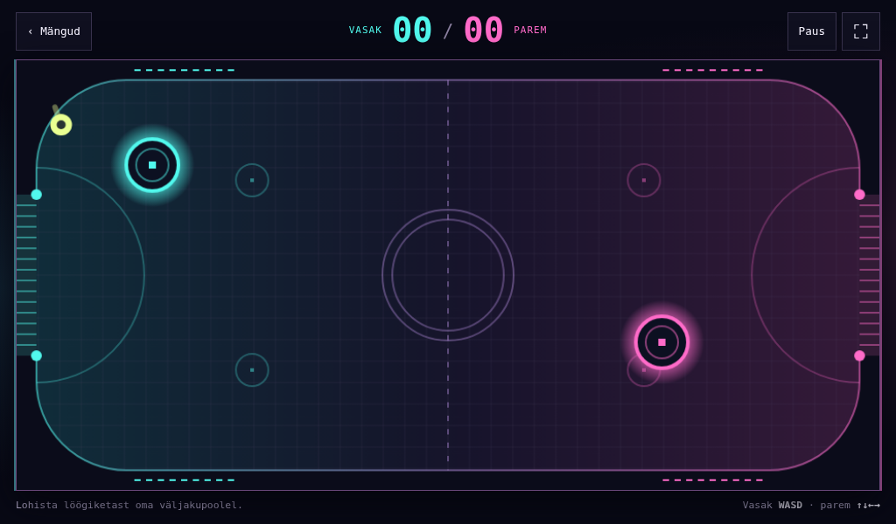
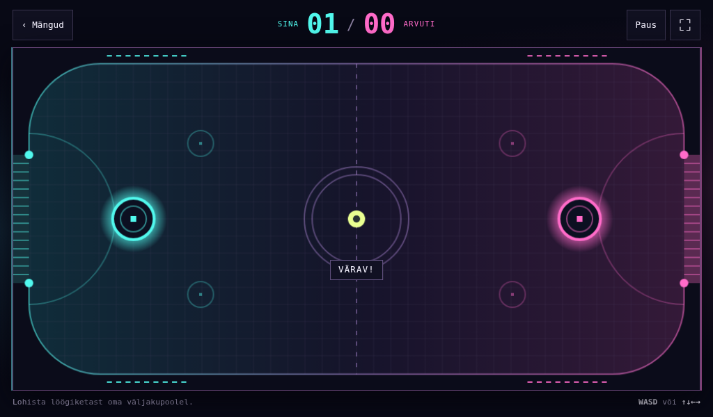
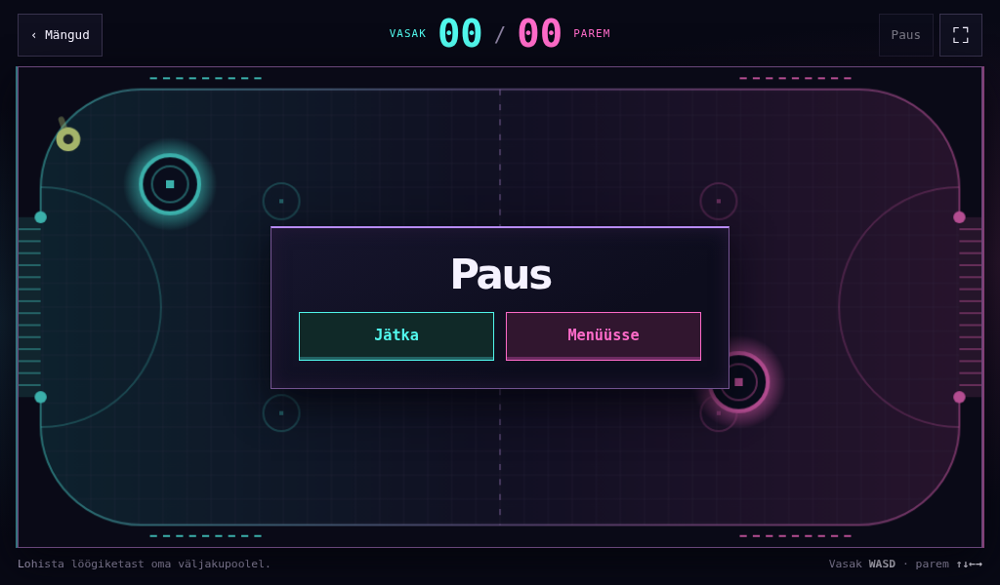

# Õhuhoki

Õhuhoki on küberpungi stiilis litrimäng. Kumbki mängija juhib löögiketast oma väljakupoolel ja üritab lüüa litri vastase väravasse.

## Käivitamine

Vali [mängude avalehelt](../index.html) **Õhuhoki** või ava [`air-hockey.html`](../air-hockey.html) Chromiumis. Repo esmakordse allalaadimise juhend on [README-s](../README.md#alusta-raspberry-pi-s). Kahe sõrmega mängimiseks kontrolli [mitmikpuudet](puuteekraan.md).

## Juhtimine ja reeglid

| Režiim | Puutega | Muu sisend |
| --- | --- | --- |
| **Üksinda** | Lohista vasakul väljakupoolel ja juhi tsüaansinist löögiketast. Roosat ketast juhib arvuti. | Vasakut ketast juhivad `WASD` või nooleklahvid. |
| **Kahekesi** | Kumbki mängija alustab lohistamist oma väljakupoolel. Mõlemad kettad liiguvad korraga. | Vasakut ketast juhivad `WASD`, paremat nooleklahvid. |

- Löögiketas liigub kahel teljel ja jääb oma väljakupoolele. Sõrm juhib sama ketast kuni tõstmiseni ka üle keskjoone liikudes. Löögiketta kiirus ja suund mõjutavad litri põrget.
- Litter põrkab poordilt ja väravapostidelt. Värav läheb kirja, kui litter on tervenisti väravajoone ületanud. Järgmine serv suundub värava sisse lasknud mängija poole. Võidab esimene mängija, kes lööb **7 väravat**.
- **Paus** või `Esc` peatab mängu. Pausimenüüst saab jätkata või naasta režiimivalikusse. **Uus mäng** alustab sama režiimiga uuesti. Täisekraani avab `⛶` või `F11`. **Mängud** viib avalehele.

## Ekraanipildid



*Litter põrkab vasakust ülemisest nurgast tagasi väljakule. Helendav jälg näitab litri liikumissuunda.*



*Värav arvutivastase vastu. Litter on tagasi keskel ja järgmine serv läheb roosa löögiketta poole.*



*Paus peatab litri ja löögiketaste liikumise. Jätkamisel taastub sama mänguseis.*

## Arendus ja failid

Pongi ühe telje juhtimisele lisasime teise telje ja kiirusest sõltuva löögi. Füüsika töötab 1/120 sekundi sammuga. Arvuti kaitseb väravat, kui litter liigub kiiresti tema poole, ja otsib löögiasendit, kui litter on tema väljakupoolel. [Esimene demoversioon](https://github.com/nullyks/puutetundliku-ekraani-mangud/commit/8dfa336)

Seadmekatsel jäi litter väljaku nurka kinni. Ümardasime nurgad nii joonisel kui ka füüsikas. Kui löögiketas surub litri vastu ümarat nurka, pääseb litter liikuma piki kaart. [Ümarnurkade parandus](https://github.com/nullyks/puutetundliku-ekraani-mangud/commit/02be7bf)

| Fail | Ülesanne |
| --- | --- |
| [`air-hockey.html`](../air-hockey.html), [`air-hockey.css`](../air-hockey.css) | Mänguleht, menüüd, punktiseis ja neoonkujundus. |
| [`air-hockey.js`](../air-hockey.js) | Canvas-väljak, puute- ja klaviatuurisisend, paus ning režiimivalik. |
| [`air-hockey-engine.js`](../air-hockey-engine.js) | Ketaste liikumine, litri põrked, serv, väravad ja arvutivastane. |
| [`air-hockey-engine.test.cjs`](../air-hockey-engine.test.cjs) | Füüsika ja mängureeglite automaattestid. |

## Testimine

Käivita repo juurkaustas järgmine käsk. Testid katavad servi, mõlema ketta liikumist, litri põrkeid, kõiki nelja nurka, kinni surutud litri vabanemist, väravaid ja arvutivastast.

```bash
node --test air-hockey-engine.test.cjs
```

**Käsitsi Pi ekraanil**

1. Vali **Kahekesi** ja lohista mõlemat ketast korraga eri suundades. Tõsta üks sõrm ja kontrolli, et teise mängija ketas allub endiselt juhtimisele.
2. Suuna litter järjest nelja nurka. Kontrolli, et litter põrkaks kaarelt väljakule. Proovi ka litrit vastu nurka suruda. Litter peab pääsema liikuma piki kaart.
3. Vali **Üksinda**. Kontrolli arvutivastase liikumist ja lööki ning veendu, et värav lisab ühe punkti ja käivitab uue servi. Proovi pausi, jätkamist ja avalehele naasmist.

Pi Chromiumis kontrollisime mõlemat režiimi, kahe puute sõltumatut juhtimist, arvutivastase lööki ja väravaid. Kahe mängijaga mängu proovisime ka füüsilisel ekraanil. Ümarnurkade paranduse järel kontrollisime Pi Chromiumis kõigi nelja nurga põrkeid ja litri vabanemist.
