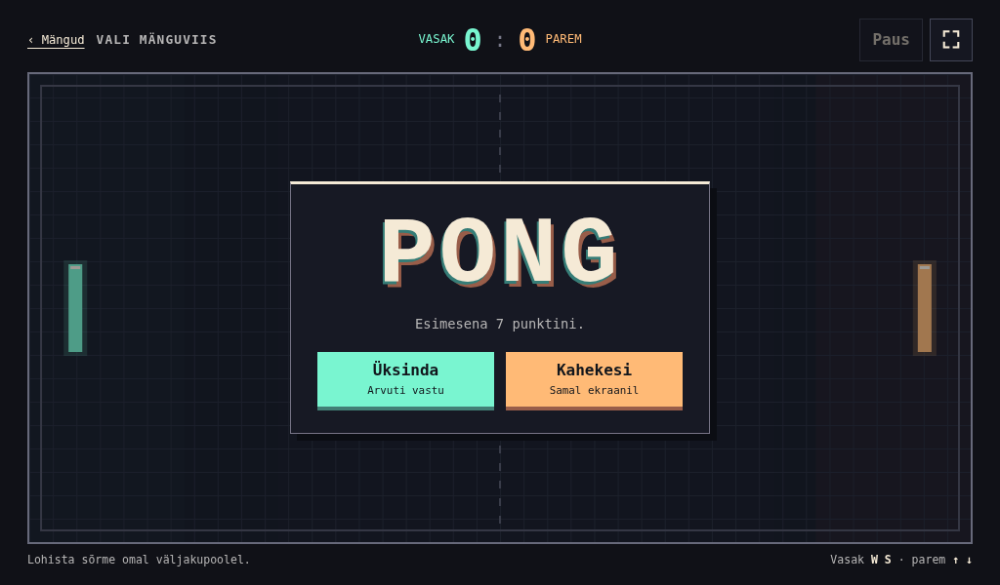
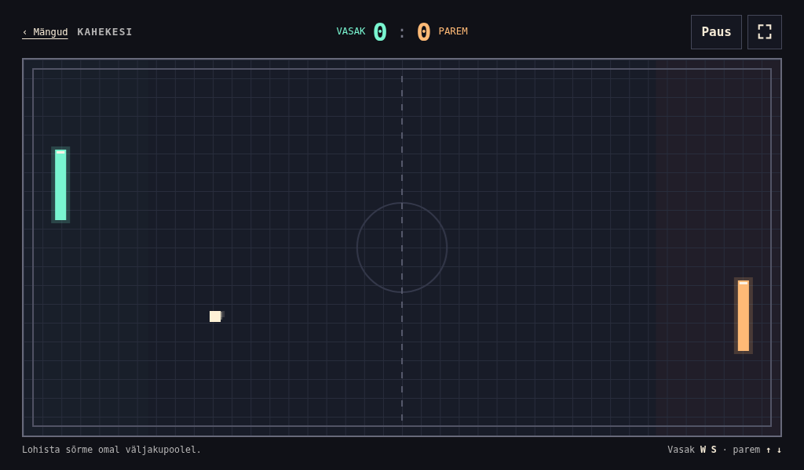
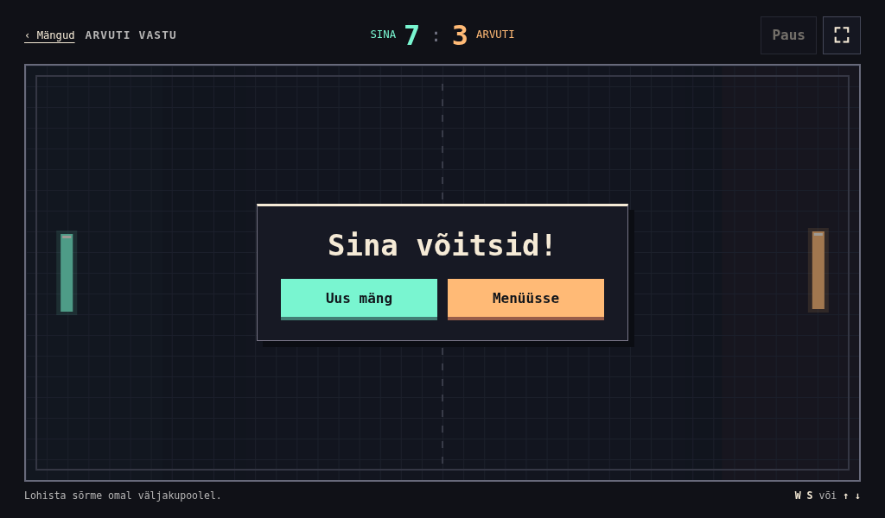

# Pong

Pong on retrostiilis reketimäng. Kumbki mängija kaitseb oma väljakuotsa, liigutades reketit üles ja alla.

## Käivitamine

Vali [mängude avalehelt](../index.html) **Pong** või ava [`pong.html`](../pong.html) Chromiumis. Repo esmakordse allalaadimise juhend on [README-s](../README.md#alusta-raspberry-pi-s). Kahe sõrmega mängimiseks kontrolli [mitmikpuudet](puuteekraan.md).

## Juhtimine ja reeglid

| Režiim | Puutega | Muu sisend |
| --- | --- | --- |
| **Üksinda** | Lohista sõrme väljaku vasakul poolel. Oranži reketit juhib arvuti. | Vasakut reketit juhivad `W` ja `S` või `↑` ja `↓`. |
| **Kahekesi** | Kumbki mängija alustab lohistamist oma väljakupoolel. Mõlemad reketid liiguvad korraga. | Vasakut reketit juhivad `W` ja `S`, paremat `↑` ja `↓`. |

- Lohistamise alguspool määrab juhitava reketi. Sama sõrm juhib seda kuni tõstmiseni ka üle keskjoone liikudes. Tõstmisel jääb reket paigale.
- Pall põrkab üla- ja alaservast ning reketitelt. Kui pall väljub vastase väljakuotsast, saad punkti ja järgneb uus serv. Võidab esimene mängija, kes kogub **7 punkti**.
- **Paus** või `Esc` peatab mängu. Pausimenüüst saab jätkata või naasta režiimivalikusse. Pärast vooru saab sama režiimiga uuesti alustada. Täisekraani avab `⛶` või `F11`. **Mängud** viib avalehele.

## Ekraanipildid



*Avamenüüst saab valida vastaseks arvuti või teise mängija.*



*Pallivahetus kahe mängija režiimis. Kumbki mängija liigutab oma reketit üles ja alla.*



*Seitsmes punkt lõpetab mängu. Võiduvaatest saab alustada uut mängu või naasta režiimivalikusse.*

## Arendus ja failid

Esimeseks demoks valisime Pongi, sest reket liigub ühel teljel ja mõlema mängija sõrm mahub oma ekraanipoolele. Enne mängu ehitamist viisime läbi kahe kontakti katse. Selle käigus lahendasime labwc hiireemulatsiooni probleemi. [Seadmekatse ja lahendus](puuteekraan.md#3-luba-mitmikpuude-labwc-s)

Brauser seob lohistamise `pointerId` järgi õige reketiga ning joonistab uue kaadri `requestAnimationFrame`-iga. Mootor arvutab liikumist ja põrkeid 1/120 sekundi kaupa. Arvuti järgib palli, kui see liigub tema poole. [Esimene demoversioon](https://github.com/nullyks/puutetundliku-ekraani-mangud/commit/c4ada50)

| Fail | Ülesanne |
| --- | --- |
| [`pong.html`](../pong.html), [`pong.css`](../pong.css) | Mänguleht, menüüd, punktiseis ja retrokujundus. |
| [`pong.js`](../pong.js) | Canvas-väljak, puute- ja klaviatuurisisend, paus ning režiimivalik. |
| [`pong-engine.js`](../pong-engine.js) | Serv, palli ja reketite liikumine, põrked, punktid ning arvutivastane. |
| [`pong-engine.test.cjs`](../pong-engine.test.cjs) | Mänguloogika automaattestid. |

## Testimine

Käivita repo juurkaustas järgmine käsk. Testid katavad servi, reketite sõltumatut liikumist, arvutivastast, kiireid põrkeid, punkti andmist ja mängu lõppu.

```bash
node --test pong-engine.test.cjs
```

**Käsitsi Pi ekraanil**

1. Vali **Kahekesi**. Lohista kahte reketit korraga eri suundades ja liiguta üht sõrme üle keskjoone. Kumbki sõrm peab hoidma sama reketit.
2. Tõsta üks sõrm ja liiguta teist edasi. Tõstetud sõrme reket peab paigale jääma, teise mängija reket peab edasi liikuma.
3. Vali **Üksinda**. Kontrolli arvutivastase liikumist, punkti lisandumist ja uut servi. Proovi pausi, jätkamist ja avalehele naasmist.

Esimest demot kontrollisime nii arendusarvuti emuleeritud mitmikpuutega kui ka Pi Chromiumis. Mängimist kontrollisime ka füüsilise puuteekraaniga.
